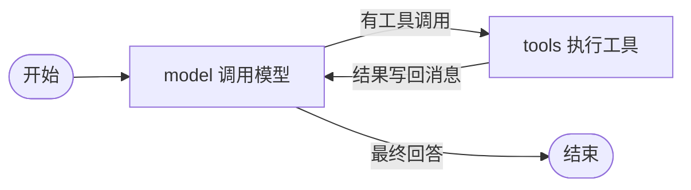

# 光晨智能技术测试：从零实现最小可用 Agent

代码仓库：[wujiefeixuxu-guangchen-agent-assignment](https://github.com/wujiefeixuxu/wujiefeixuxu-guangchen-agent-assignment)。

使用 **Node.js + TypeScript** 从零实现 Agent Runtime。主流程、节点调度、边路由、状态流转和工具执行均由本项目实现，没有使用 Agent 框架或模型 SDK。

运行时只使用 Node.js 内置能力。直接开发依赖为 TypeScript 和 Node.js 类型定义；要求 Node.js **24.12.0+**。

## 运行

新环境先安装依赖；已有`.env`时保留原文件，没有时从空模板创建。然后在本地填写`DEEPSEEK_API_KEY`，启动页面：

```powershell
npm install
if (-not (Test-Path -LiteralPath .env)) { Copy-Item .env.example .env }
# 在本地编辑 .env，填写自己的 DEEPSEEK_API_KEY
npm run web
```

打开 `http://127.0.0.1:3210`。页面与 API 由同一个 Node.js 进程提供，浏览器代码同样使用 TypeScript，没有引入前端框架、服务端框架或数据库驱动。页面提供独立会话、聊天记录、待办和完整工具日志。

命令行入口仍可直接使用，与页面共用 SQLite：

```powershell
npm install
npm start -- --user-id A --thread-id window-1 "搜索 Node.js 教程，读取搜索结果的网页正文，再用计算器完成正文练习。"
```

也可以执行 `npm start`，根据提示输入一项任务。每次输入创建一轮独立运行；复用用户与 thread 标识时会加载原会话的完整历史和待办。终端显示状态、节点执行轨迹、工具结果、调用统计、日志文件位置和最终回答。按 Ctrl+C 可以取消正在执行的任务。

当前有六个工具：`calculator`、`search`、`fetch`、`write_todos`、`memory_read`、`memory_write`，定义与注册集中在 `src/tools/builtin.ts`。模型通过 DeepSeek Chat Completions API 自主选择工具；搜索和网页抓取只读取本地 Mock 资料，不请求 DeepSeek Search/Fetch API，也不访问目标网页。

## 环境变量

程序通过 Node.js 的 `--env-file-if-exists=.env` 将本地 `.env` 加载到进程环境，再从 `process.env.DEEPSEEK_API_KEY` 读取密钥。`.env`被`.gitignore`忽略，不随源码提供，需要运行者在本地配置。密钥只用于请求认证，不进入对话、状态或日志。

在新环境中先复制模板，再在本地填写密钥：

```powershell
Copy-Item .env.example .env
```

已有的系统或进程环境变量优先于 `.env`。本项目不会修改 Windows 全局环境配置。

| 变量 | 默认值 | 用途 |
| --- | --- | --- |
| `DEEPSEEK_API_KEY` | 必填 | DeepSeek 官方 API Key |
| `DEEPSEEK_BASE_URL` | `https://api.deepseek.com` | API 地址 |
| `DEEPSEEK_MODEL` | `deepseek-flash` | 模型名称 |
| `DEEPSEEK_THINKING` | `enabled` | 思考模式开关，支持 enabled / disabled |
| `DEEPSEEK_REASONING_EFFORT` | `max` | 思考强度，支持 low / high / max |
| `DEEPSEEK_TIMEOUT_MS` | `120000` | 单次模型请求超时 |
| `DEEPSEEK_MAX_OUTPUT_TOKENS` | `131072` | 思考、工具调用和答案共用的输出 token 上限 |
| `AGENT_MAX_STEPS` | `40` | 最大节点执行次数，包含工具节点 |
| `AGENT_MAX_MODEL_CALLS` | `20` | 单次用户任务的模型实际调用上限，包含摘要调用 |
| `AGENT_CONTEXT_UNIT` | `tokens` | 默认按提供商 token 计数触发压缩；characters 为兼容模式 |
| `AGENT_CONTEXT_MAX_TOKENS` | `100000` | token 模式的压缩触发线，可改为 200000 |
| `AGENT_CONTEXT_MAX_CHARS` | `48000` | 仅 characters 兼容模式使用的字符阈值 |
| `AGENT_CONTEXT_RECENT_TURNS` | `4` | 压缩时优先保留的近期完整对话轮次 |
| `AGENT_TIMEOUT_MS` | `300000` | 单个任务的最长执行时间 |
| `AGENT_LOG_DIR` | `logs` | 完整 JSONL 日志目录 |
| `AGENT_DATA_DIR` | `.agent-data` | 按用户和 thread 保存待办的目录 |
| `AGENT_DB_PATH` | `.agent-data/agent.sqlite` | 本地 SQLite 数据库路径，未显式设置时位于数据目录下 |
| `PORT` | `3210` | 页面服务端口，只监听本机 127.0.0.1 |

默认开启思考模式，使用官方最高档位 `reasoning_effort: "max"`，保留非流式响应；页面在每次模型返回后展示该次思考。直接通过内置 `fetch` 请求 DeepSeek 官方 Chat Completions API，无模型 SDK。参数依据 [DeepSeek 思考模式文档](https://api-docs.deepseek.com/guides/thinking_mode/) 和 [Chat Completions 参数](https://api-docs.deepseek.com/api/create-chat-completion/)。`max` 是思考强度；131072 是输出预算，模型按任务实际生成，用量记录服务端返回值。

### 思考、工具与答案解析

解析器分开读取 `reasoning_content`、`tool_calls` 和 `content`，分别保存为 `reasoningContent`、具体工具调用及最终答案。思考正文不是最终答案；只有思考而没有答案或工具调用时明确报错。字段类型错误、重复调用 ID、非法结束原因和输出被截断均拒绝作为成功回复。输出达到上限时，错误提示说明思考和答案共用预算。

带工具请求按官方协议完整回传所有保留历史助手消息的思考，包括未调用工具的最终回复；SQLite 恢复后仍然保留原文。旧非思考历史使用空思考字段兼容，不生成虚构思考。摘要器的输入仅保留旧用户目标、答案和工具事实，不重复灌入旧思考；当前轮次的完整思考和工具对不会被截断。真实模型某些步骤可能返回空思考或0个思考token，页面按实际结果显示。

页面把思考放在独立折叠区，把工具参数、结果、错误和调用 ID 放在执行卡片中，最终回答单独排版。执行面板显示每轮模型决策以及真实输入、输出、思考和缓存 token；思考 token 是输出 token 的一部分。原始请求和事件仍可展开检查，普通聊天不会显示程序追加的状态快照。

## 状态、节点和边

运行状态固定为四个，保存在 `status` 字段中：

```text
待运行 pending → 运行中 running → 完成 completed
                              ↘ 失败 failed
```

完成、失败都是终态。模型和工具之间循环时保持运行中。

其余字段保存执行数据：`messages` 记录对话与工具结果，`pendingToolCalls` 记录待执行调用，`finalAnswer` 保存最终回答，`steps` 和 `trace` 记录节点执行情况，`error` 保存失败原因。`identity` 保存用户、thread 和 run 标识；`metrics` 保存实际调用统计；`logs` 返回本次完整事件记录；`todos` 保存当前 thread 的完整待办清单。



- **节点**：异步函数，返回更新后的消息、待执行工具调用和最终回答。
- **边**：读取当前执行数据，决定下一个节点。`model` 有工具调用时进入 `tools`，否则结束；`tools` 执行后回到 `model`。
- **Runtime**：执行循环，独立控制运行状态、步数、超时和取消。`end` 只是流程出口标记。

每执行一次 `model` 或 `tools` 节点，`steps` 加一。同一轮的多个工具按顺序执行，算一次 `tools` 节点。达到上限、请求失败、无效模型响应、超时或取消会进入失败状态。可修正的工具错误作为结构化结果交还模型，模型可以修正参数后继续。

## 内置工具

| 工具 | 参数 | 功能 |
| --- | --- | --- |
| `calculator` | `a`, `b`, `operation` | 四则运算；operation 枚举为 `+`、`-`、`*`、`/` |
| `search` | `query`，可选 `count` | 搜索本地模拟资料，返回标题、链接、摘要 |
| `fetch` | `url` | 读取同一份模拟资料中的标题和 Markdown 正文 |
| `write_todos` | `todos` | 整表创建、修改、完成、删除或清空当前 thread 的待办 |
| `memory_read` | 可选 `id` | 无 ID 时读取当前用户的最新索引，有 ID 时读取完整 Markdown 正文 |
| `memory_write` | `operation`、`id`，upsert 时另需 `name`、`summary`、`content` | 用户明确要求时单条创建、更新或删除长期记忆 |

搜索和抓取沿用 [DeepSeek Search](https://api-docs.deepseek.com/api/search/) 和 [Fetch](https://api-docs.deepseek.com/api/fetch/) 的最少参数命名：`query` 最多 128 个 Unicode 字符；`count` 默认 10，必须是 1～50 的整数；`url` 最多 8192 个字符，只接受不含用户名和密码的 HTTP/HTTPS 地址。

Mock 数据集中在 `src/tools/mock-pages.ts`。搜索返回的 URL 可以直接用于抓取。没有搜索结果时成功返回空数组；模拟资料没有对应网页时返回 `MOCK_PAGE_NOT_FOUND`。所有搜索和抓取结果标记 `mock: true`，系统提示要求模型明确说明数据为模拟资料。

工具通过注册表按名称查找。每个工具提供名称、描述、参数 Schema、类型明确的 `parse` 和 `execute`。注册表用泛型连接参数校验与执行函数，保留各工具的具体参数类型。计算使用 JavaScript 双精度数字，通过固定分支处理符号，不执行动态代码。

参数错误作为结构化工具结果返回模型，例如 `a: "12A"` 返回 `INVALID_ARGUMENT`、字段 `a` 和具体说明；不会把它截成数字 12。原始 JSON 本身损坏时返回 `INVALID_JSON`。缺参、非法运算符、除零、溢出、未知工具和工具异常也各有错误码。模型可以修正参数后重新调用。

结果统一为 `{ ok, result/error, meta }`。`meta` 包含用户、thread、run、工具名、模型调用 ID、本地调用记录 ID、调用序号、时间戳和耗时。协议中的 `tool_call_id` 始终回填模型原始 ID。

完整结果和 `meta` 保存在原始消息、SQLite 和日志中。发送给模型的副本只移除工具结果信封中的日志 `meta`，业务结果、错误详情、网页正文和协议调用 ID 均保留。

新增工具时实现 `Tool<参数类型, 结果类型>`，再调用注册表的 `register`。`execute` 接收经过校验的参数以及 Runtime 注入的上下文，其中包括身份、调用序号和取消信号。自定义异步工具应响应 `AbortSignal`；Runtime 到时会返回失败，但不能强制终止工具自行启动的外部副作用。

## write_todos

待办只有一个工具入口，创建与更改都使用整表替换。模型每次提供需要保留的所有事项，Runtime 校验、保存并回传完整清单：

```json
{
  "todos": [
    { "content": "搜索资料", "status": "completed" },
    { "content": "读取网页", "status": "in_progress" },
    { "content": "整理答案", "status": "pending" },
    { "content": "处理错误", "status": "failed", "error": "没有找到对应的模拟网页" }
  ]
}
```

单项状态为 `pending`（等待）、`in_progress`（正在进行）、`completed`（完成）、`failed`（失败）。失败项必须提供非空 `error`；其他状态省略 `error` 或设为 `null`，保存时统一为 `null`。失败后可以由模型改回进行中并重试，普通工具成功不会自动更改待办状态。

Runtime 不再把清单拼进系统消息。新用户输入带一次冻结的完整运行快照，每个工具批次完成后，在所有配对的工具结果之后追加一次 `role: user` 状态更新。快照包含当前完整 Todo、按四种状态统计的进度、已调用模型次数与上限、实际工具执行次数，以及最近工具批次的名称、调用 ID 和成功或错误信息。普通工具成功不会自动完成 Todo；`write_todos` 的工具结果和 `todos.updated` 日志仍包含完整清单。

同一轮回复中的多个 `write_todos` 全部返回 `MULTIPLE_TODO_WRITES`，不会执行或覆盖清单；模型可以合并后重试。该轮其他工具仍可正常执行。`todos: []` 表示清空，未出现在新列表中的旧事项会被删除。

全部待办完成后，模型先写入完成状态，再在下一轮给出最终回答；写入或清空成功本身不会让 Agent 自动结束。待办状态与 Agent 运行状态独立：一轮“查询待办”的回复可以完成，同时清单里仍保留等待或失败事项。

CLI 与页面使用 SQLite 保存待办。所有查询和整表替换都按 `userId + threadId` 隔离；复用标识可以在新进程中加载已有清单，完成的清单不会自动清除。同一 session 执行中重复提交消息会返回 409，其他 session 可以并行执行。

```powershell
npm start -- --user-id A --thread-id window-1 "先用write_todos记录计算12乘3，计算后更新为完成，再回复结果。"
npm start -- --user-id A --thread-id window-1 "列出当前待办及其状态，不要修改。"
npm start -- --user-id A --thread-id window-2 "列出当前待办。"
```

程序化创建的 Runtime 默认仍使用内存待办存储。`SessionService` 在它外层接入 SQLite 历史与运行记录；`JsonTodoStore` 保留用于旧数据读取和独立测试。启动 CLI 或页面时，旧 JSON 待办会导入尚不存在的 SQLite 会话，原文件保留，已有数据库清单不会被覆盖。

## Session 管理

一个 session 对应独立的历史消息和待办。每次用户输入产生新的 run，run 保留各自的 ID、四状态和工具调用日志。

- 窗口一查天气并记录待办，窗口二写周报并记录待办，两份上下文互不混用。
- 新窗口默认创建新 session；同一窗口刷新时从 URL 和标签页存储恢复选中的 session。
- 从左侧列表打开原 session 时，消息、待办与执行记录全部从 SQLite 恢复。
- 选中会话不写入跨窗口共享的 localStorage；用户标识也按当前窗口发送。
- 完整模型历史包含助手的工具请求和对应工具结果，续聊时保留原始调用关联 ID。
- 失败轮保留用户输入及失败说明，完整中间过程仍在运行日志中，避免把悬空工具请求交给下一轮模型。
- 服务重启时只将已退出进程的遗留运行标记为失败，保留会话；不会自动重复执行工具。

SQLite 使用 Node.js 内置 `node:sqlite`，会话数据保存在 `sessions`、`messages`、`todo_items`、`runs`、`run_events`、`session_context` 中，长期记忆另用 `memories` 表。启用外键和 WAL，SQL 查询均绑定参数，写入使用事务。参见 [Node.js 24 SQLite 文档](https://nodejs.org/download/release/v24.20.0/docs/api/sqlite.html)。

页面的“用户 A / 用户 B”用于本地演示身份隔离，不包含真实账户登录或生产鉴权。服务只监听本机，API Key 仅在服务端读取，不返回给浏览器。

## 长期记忆：读写、召回与放置

这是自行实现的轻量记忆库，复用现有 Runtime、工具注册和 SQLite，不使用记忆框架、向量库或嵌入模型。`memories` 表仅有六个字段：`id`、`user_id`、`name`、`summary`、`content`、`recorded_at`，主键为 `(user_id,id)`。正文为 Markdown；`preferences` 是普通记忆的固定 ID，作为常驻偏好使用。

### 召回时机和上下文位置

每次真实用户输入开始一个新 run：加载当前用户的记忆一次，固定按 ID 排序，生成偏好全文及其他记忆的 JSON 索引。索引仅含 `id`、`name`、`summary`、`timeLabel`，不发送普通记忆正文或准确时间。偏好正文和索引加入本轮 system，整轮冻结。

模型根据简介判断相关性，需要细节时调用 `memory_read`；工具结果以原生 `role: tool` 追加。写入同样只追加结果，不重建本轮 system。快照描述开始时的数据，当前用户明确要求与本轮新产生的工具结果优先；下一条用户输入才加载更新后的快照。旧轮次正文和相对时间属于旧快照，不能覆盖本轮索引，跨轮需要正文时重新读取。读取记忆属于真实工具调用，遵守原有计数、超时和日志规则。

字段顺序、索引排序和空白格式固定。相同数据与时间标签产生相同文本；跨天或记忆改动可能改变下一轮 system 对应的前缀，本轮工具循环不会因这些变化重写前缀。

### 时间和写入规则

数据库保存准确 UTC ISO 时间；给模型和页面的索引用北京时间自然日换算成“今天、昨天、前天、三天前、约一周前、约半个月前、约几个月前、约几年前”。相对时间在 run 开始时计算，跨午夜也不刷新当前快照。读取、改名、改简介和重复写入不刷新时间。普通 Agent 新写入使用本轮用户消息真实入库时间，手工编辑正文使用保存时间；整理旧记忆保持原时间。它描述记录时间，不自动推断事实发生日期。

用户可在页面“记忆”页签查看、编辑、删除；Agent 仅在用户明确要求记住、更正或忘记时调用 `memory_write`。`operation` 只有 `upsert`、`delete`，upsert 需完整提供名称、简介和正文；所属用户、准确时间不能由模型传入。参数校验拒绝越权字段和过长内容，不静默截断。

记忆按用户跨会话共享，只有明确保存到库中的信息才进入这一层。聊天、摘要、Todo 和任务执行记录仍按 session 隔离。删除针对长期记忆库，当前聊天原文和执行日志不会被清除；Agent 不应依据旧聊天自动恢复删除记录。

### 手动整理

点击“整理记忆”后，当前会话产生一轮普通 Agent 任务，读取已保存记忆、去重、合并并修正简介。第一版只整理现有库，不自动扫描旧聊天提取新记录，也不运行后台模型。整理模式不能新建或恢复 ID，保留原时间和偏好记录；删除重复项前，必须先成功保存另一个保留 ID。无须修改时允许直接结束，任务仍受20次模型调用限制。

`memory.loaded` 保存本轮实际记忆快照，`memory.updated` 和正常工具事件记录每次改动。所有查询带当前用户条件，取消或已完成工具的旧上下文不能迟到修改记忆。程序化 Runtime 默认使用内存后端，`SessionService` 接入持久化 SQLite。

## Context 管理

每次用户输入开始新的运行，最多实际调用模型 **20 次**。决策请求和无工具的摘要请求共用计数、总超时和日志，达到上限后明确报错；下一条用户消息重新计数，整个 session 不受“20 条聊天消息”的限制。节点步数另设 40 次保护。

模型请求保留系统规则、工具 Schema、最新完整 Todo、当前用户这一轮的完整消息，以及未被摘要覆盖的近期对话。开启思考后，保留历史中的助手思考按工具协议完整回传；它不作为新的系统规则。普通追问可读取历史结果，工具追问可以用旧结果发起新的工具调用。

### 模型输入协议

消息由 `src/prompt.ts` 和 `src/memory.ts` 统一构造，工具 Schema 使用独立的 `tools` 字段。行为规则固定；偏好和记忆索引在每轮开始时追加到 system 并冻结，摘要与运行状态不写入 system：

```text
system：固定行为规则 + 本轮偏好正文（Markdown）+ 本轮记忆索引（JSON）
user：历史摘要（压缩后存在，同一版摘要保持不变）
……未压缩的历史 user / assistant / tool 消息……
user：【用户输入】+ 原文的 JSON 字符串 + 分隔线 +【运行上下文】+ JSON 快照
assistant：原生工具调用，保留模型调用 ID
tool：第一条配对的完整工具结果
tool：同批其他工具结果
user：【运行上下文更新｜程序生成，非新增用户请求】+ 更新原因 + 最新 JSON 快照
assistant：继续调用工具或最终回答
```

快照的生成时机固定为：接收新输入、完整工具批次结束、压缩成功。工具与压缩发生在同一决策轮次时，两种原因合并为一条尾部更新；分批摘要期间只重新计算尚未发送的候选快照。摘要生成也计入模型预算，最终快照和 token 计数都包含这些调用。

用户原文和冻结的快照分别保存在消息中；页面继续显示原文，程序更新不显示为用户发言。状态消息有独立的本地来源标记，压缩边界只认真实用户输入，不会在工具结果和其状态更新之间切开。旧消息的快照不随最新 Todo 或计数重新渲染，SQLite 恢复后使用原来的快照；只向后追加新记录。

本地 Todo 是覆盖当前值，模型消息是追加历史。最近工具批次只引用工具身份、执行情况与错误，网页等完整正文保留在对应工具消息中，不再复制到快照里。`model.started` 日志保存实际发送的完整 `messages`、`tools` 和调用用途，可以检查模型看到的内容。前缀一致性由程序验证；服务端实际缓存命中仍以 `usage` 中的缓存 token 数为准。

恢复会话时，最近工具批次从该用户、该会话的执行事件中读取。因此上一轮因预算、网络或取消而失败时，已经执行或被拒绝的工具仍能出现在新输入的快照里，不会因为失败轮次隐藏了中间聊天消息而退回更早的工具记录。

默认在发送前调用提供商兼容计数接口，按 `input_tokens` 判断是否超过 100000 token，再将旧的完整用户轮次分批交给同一个模型生成摘要。优先保留最近 4 轮原文；如果仍超过阈值，可以继续摘要更近的已完成轮次。每批包含完整旧记录，不拆断工具请求与结果。生成响应中的 `usage.prompt_tokens`、输出用量和缓存用量会独立保存，作为实际使用规模的验证依据。

计数接口请求不生成文本，单独统计为 `tokenCountRequests`，不占用20次模型生成轮次。一次整理中会缓存同份输入的计数结果，按完整轮次二分选择摘要批次。兼容接口计数与生成接口真实用量分别记录，不按固定字符/token比例换算。需要旧的字符测试时设置 `AGENT_CONTEXT_UNIT=characters`，或程序化只传 `context.maxChars`。

摘要最多 **4000 个 Unicode 字符**。模型首次返回过长摘要时会要求重新生成一次；仍不合格则本轮报错，保留之前的有效摘要和全部原文。摘要请求禁用工具，重点保留目标、约束、明确决定、数字、单位、网址、工具事实和未解决事项。`session_context` 按用户及 session 保存摘要和覆盖的消息数，后续运行或新进程可以复用。

**网页正文不截断。** 当前用户这一轮的工具结果和网页原文始终保留完整；旧轮次可以整体进入历史摘要。100000 token 是应用压缩触发线，并没有改变模型原生窗口：如果系统规则、最新待办、当前输入和本轮完整网页已经超过它，仍会完整发送，并记录 `overBudget: true`。模型服务自身的上下文限制仍可能返回错误。

压缩只作用于模型输入副本，`AgentState.messages` 和 SQLite 原始记录不裁剪。这样历史摘要不会影响本轮消息保存的偏移位置，也不会导致助手回复丢失。`context.compacting`、`context.compacted`、`context.prepared` 记录覆盖范围、摘要长度和发送前后的字符数；每次模型调用还标记 `purpose: agent/summary`。

```powershell
# 默认不联网的完整检查
npm run check

# 可选真实模型验证，使用独立 context-smoke.sqlite 和日志目录
npm run smoke:context
```

真实验证脚本检查：长历史生成摘要后，纯追问仍记得计算结果及项目代号，工具追问可以继续计算；原始历史仍完整保存在测试 SQLite 中。该命令会使用配置的 DeepSeek Key。

### 历史大语料测试（当前不要求运行）

当前正常运行保持10万token压缩触发线，测试方案优先使用已有自动化和小规模场景，不新增100万或200万token压力目标。下面的旧脚本仅保留供自愿研究，不是提交时必须执行的检查。

<details>
<summary>查看历史小说长上下文脚本（会调用真实模型）</summary>

```powershell
npm run stress:novel -- --target-tokens 250000 --limit-tokens 100000
# 只校准并导入资料，后续在页面手动试写
npm run stress:novel -- --target-tokens 250000 --limit-tokens 100000 --prepare-only
```

脚本先用本地程序合成小说资料并调用计数接口校准到20～30万输入 token，再在新会话中导入。历史回执明确标注“非模型生成”，不把它们算成模型逐章创作。随后真实模型依次完成：完整上下文写作基线、切换压缩触发线、10个早中晚事实锚点回忆、压缩后续写和 Todo 更新。

基线阶段为便于对比临时使用较大的应用阈值，压缩阶段切回指定的10万或20万线。最终规模以生成响应 `usage.prompt_tokens` 验收。输入允许100万字符、HTTP JSON体上限8MiB，支持长文粘贴。长压测配置单次请求超时120秒、任务总时限300秒，不覆盖普通应用的超时设置。

测试会话保存在主 SQLite 的用户 A 下，原有会话不覆盖。材料、压缩前写作、压缩后续写、摘要和 JSON 报告放在 `.agent-data/novel-stress/<sessionId>/`。自动回忆分数与后续诊断分开保存，不用补问结果篡改首轮评分。这是合成语料的压力测试，不等于所有真实小说情节都已验证。

</details>

## 调用日志

CLI 把完整事件追加到 `logs/<runId>.jsonl`，每行一个 JSON 对象。该目录被 Git 忽略；配置的 API Key 会在文件写入时脱敏。日志中不记录认证请求头。

- `userId`、`threadId`：由调用方提供，用于区分用户和窗口，模型不能通过工具参数覆盖。
- `runId`：每次任务生成的新 ID。
- `toolCallId`：模型提供的调用 ID，负责协议关联。
- `invocationId`：本地为每个工具请求生成的新 ID，模型复用 ID 时仍可区分调用。
- `step`、`modelCallNo`、`toolCallNo`：节点步数、模型调用序号、工具请求序号。
- `actualExecutionCount`：真正开始执行工具函数的累计次数；参数校验失败不会增加。
- `timestamp`：UTC ISO 时间。`durationMs` 使用单调时钟计算；工具结果另含 requestedAt/startedAt/finishedAt，以及实际执行耗时 executionDurationMs。

事件覆盖运行状态、节点开始、模型开始/成功/失败、工具请求/开始/成功/拒绝/失败、待办更新、上下文整理/压缩及最终统计。请求参数、模型消息、工具结果和错误可沿 ID 关联。超时或步数上限中止时，也会关闭尚未完成的调用记录；迟到结果不重复追加日志或增加统计。

`metrics` 分开统计模型生成调用、token计数请求、工具请求、实际执行、成功、拒绝和执行失败。参数 `"12A"` 被拒绝属于请求一次、实际执行零次；除零发生在执行函数中，属于实际执行一次、执行失败一次。

当前 `--thread-id` 同时用于恢复该用户的完整聊天历史、待办和运行记录。数据库中的 `run_events` 与 JSONL 事件日志使用同一套 runId、toolCallId 和 invocationId。

## TypeScript 与验证

完整测试方向、场景输入、预期结果与覆盖状态见 [测试方案与验收用例](docs/TEST-PLAN.md)。其中明确区分已有自动化、历史真实机制验证和待场景验收；列出用例不等于已经执行。当前共有93个自动化用例，默认检查不访问真实模型。

开启 `strict`、`noUncheckedIndexedAccess`、`exactOptionalPropertyTypes` 等检查。业务模型使用具体接口、联合类型和只读字段；没有显式 `any`，`unknown` 只用于异常归一化函数的输入。JSON 解析在单一边界转换为递归 `JsonValue` 类型，然后逐项校验外部字段。

```powershell
npm run typecheck
npm test
npm run build
# 或一次执行以上全部检查
npm run check

# 运行编译后的 JavaScript
npm run start:built -- "搜索上海天气示例，再读取对应的模拟网页。"
```

测试使用 Node.js 内置测试工具，覆盖四状态、多轮工具调用、12A 参数报错与修正、Mock 搜索抓取链、工具不联网、多工具关联、并发任务日志隔离、实际执行统计、步数上限、超时与迟到结果、JSONL 脱敏、HTTP 请求编码和响应校验。待办测试覆盖整表回传、四状态、失败重试、重复写入拒绝、用户及窗口隔离、新 Runtime 恢复、串行更新、磁盘错误和迟到修改拒绝。Session 测试覆盖 SQLite 重新打开、两窗口完整历史隔离、忙时重复提交、失败后继续、旧数据迁移、取消和中断恢复、本地 HTTP API。默认测试使用本地 HTTP 服务器及测试模型，不访问真实 API、不消耗模型额度。

Node.js 可直接执行本项目的可擦除 TypeScript 语法，但不会自动检查类型，所以类型检查与构建是独立命令。参见 [Node.js TypeScript 文档](https://nodejs.org/docs/latest-v24.x/api/typescript.html)。

## 依赖说明

直接开发依赖只有 `typescript` 和 `@types/node`。间接安装的 `undici-types` 是 Node.js HTTP 接口的类型定义，`@typescript/typescript-win32-x64` 是当前 TypeScript 编译器的 Windows 执行文件。其他平台的可选包不会在本机安装。运行时依赖为零。

## 代码入口

提交阅读入口：[测试方案与验收用例](docs/TEST-PLAN.md)、[AI Prompt 记录](docs/PROMPTS.md)、[问题解决记录](docs/DECISIONS.md)。源码仓库链接见文首，真实模型脚本仅在需要时手动执行。

```text
src/
  index.ts           命令行入口
  server.ts          本地页面服务入口
  http-server.ts     页面静态资源与会话 API
  session-service.ts 消息、运行及 Runtime 的协调
  sessions.ts        持久化消息校验与本地 API 错误
  sqlite-store.ts    SQLite 会话、消息、待办及日志存储
  web/client.ts     页面交互，编译后在浏览器运行
  web/contracts.ts  页面与本地服务的共享协议类型
  state.ts           四状态和任务执行数据
  types.ts           消息、模型、工具类型
  graph.ts           节点入口和边路由
  nodes.ts           model 与 tools 节点
  runtime.ts         自写执行循环
  prompt.ts          固定消息协议、冻结快照与工具结果投影
  context.ts         完整轮次摘要、token 预算与 4000 字符校验
  execution.ts       运行上下文、调用 ID、统计与事件
  logging.ts         JSONL 日志写入
  cli.ts             命令行用户与 thread 标识
  abort.ts           异步操作取消
  config.ts          环境变量配置
  json.ts            外部 JSON 解析及字段校验
  errors.ts          异常归一化
  tool-errors.ts     工具结构化错误码
  todos.ts           待办类型和参数校验
  memory.ts          六字段记忆、相对时间、JSON索引和system快照
  memory-store.ts    记忆存储接口与内存后端
  todo-store.ts      按用户和 thread 隔离的内存及 JSON 存储
  models/deepseek.ts  DeepSeek HTTP 客户端
  model-output.ts    思考正文、服务端 token 用量及持久化字段校验
  tools/registry.ts  工具注册及执行
  tools/builtin.ts   计算、Mock搜索/读取、Todo和两个记忆工具的定义与执行
  tools/mock-pages.ts 搜索和抓取共用的模拟资料
test/                状态、Runtime、工具、HTTP、配置测试
public/              轻量页面样式与入口
```
